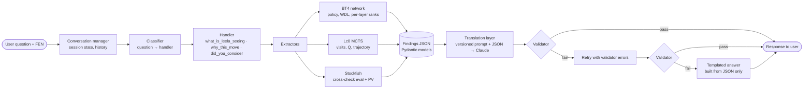

# leela-chat

**Ask Leela Chess Zero why it plays a move, and get an answer grounded in what the engine actually computed.**

leela-chat is a conversational interface to [Lc0](https://lczero.org/) (Leela Chess Zero). You load a position, ask a question in plain English ("Why Rxd4?", "Did you consider Kg5?", "What is Leela seeing here?"), and the system extracts hard signals from the engine: the BT4 network's policy and win/draw/loss head, per-layer move rankings inside the transformer, the MCTS search tree and its Q-value trajectory, plus a Stockfish cross-check. A frontier LLM (Claude) then turns that JSON into prose. **The LLM is only a translator.** A deterministic validator checks every move and every number in its answer against the extracted data and blocks anything invented.

## Example

Real output from the evaluation run on 2026-05-24 (`why_this_move` handler, deep mode). It was generated by an earlier prompt version and is copied verbatim from [`tests/eval/smoke_summaries/2026-05-24-postv6-subjective.md`](tests/eval/smoke_summaries/2026-05-24-postv6-subjective.md) (Cell 5).

```bash
uv run python -m leela_chat.cli ask \
  --fen "1r1r2k1/5ppp/p3pn2/4q3/b1PN4/Q4P2/P2RB1PP/KR6 b - - 0 1" \
  --question "Why Rxd4?" --move d8d4 --deep
```

> Yes, Rxd4 is Leela's committed pick — 4311 of 4876 visits (88%) at Q +0.92, squarely in the winning bucket. This is a striking case where the network's pattern recognition doesn't suggest this move at any layer of computation: rank 43 at L=0, drifting in the 30s through most of the network, and only climbing to rank 14 at L=14 and rank 9 at L=15 — Rxd4 never enters BT4's top-5 at any depth, and its final-layer policy share is just 6.79%. The move's discovery is a search artifact, not a network-emergence finding. Search-time, Q opened at +0.56 with no visits, briefly dipped to a +0.42 trough before any expansion, then jumped to +0.92 by visit 12 and peaked at Q +0.96 around visit 359 as PUCT progressively committed; the post-peak settling to +0.92 across 4311 visits reflects deeper refutations of secondary lines, not weakness in the move. The runner-up by visits is Rbc8 at Q +0.81 (127 visits) — still in the winning bucket but a clear step down, and the network's high-prior alternative Rxb1+ hit a Q trough of +0.37 around visit 22 with visits stagnating near 92 (under 2% of search), confirming search refuted the policy's favourite. Stockfish at depth 15 agrees emphatically: Rxd4 first at −4.02, with the runner-up Ra8 only at −1.60 — a cross-bucket downgrade. The Stockfish line runs Rxd4 Qc3 Rxb1+ Kxb1 Qb8+, where the rook sacrifice opens the queen-and-bishop battery against the exposed white king.

## Architecture



Layer rules: extractors return only facts (numbers, FENs, UCI moves) as Pydantic models; handlers orchestrate extractors and contain no chess logic; the translation layer is the only place the LLM is called; nothing reaches the user without passing the validator. Prompts are versioned per handler under [`leela_chat/llm/prompts/`](leela_chat/llm/prompts/).

## How the validator works

The validator ([`leela_chat/validator/`](leela_chat/validator/__init__.py)) is purely mechanical, with no LLM involved. It extracts every SAN/UCI move from the response and checks with python-chess that each one is legal in the position or appears in an engine line from the findings. It extracts every signed evaluation and percentage and checks that it matches a value in the findings JSON (or a ratio derivable from it, such as visit share) within tolerance. If a check fails, the LLM is retried once with the specific errors attached. If that also fails, the user gets a templated answer rendered directly from the JSON, so an unvalidated response is never shown.

## Setup

**Requirements**

| Component | Notes |
|---|---|
| Python 3.11 + [uv](https://docs.astral.sh/uv/) | `uv sync` installs everything (PyTorch CUDA 12.8 build; CPU build on WSL) |
| BT4 network | `BT4-1024x15x32h-swa-6147500`: [ONNX](https://huggingface.co/andyrdt/leela-chess-bt4-onnx) for the network forward pass, [`.pb.gz`](https://huggingface.co/shermansiu/lc0_BT4-1024x15x32h-swa-6147500) for Lc0. SHA-256 hashes are in [`docs/DECISIONS.md`](docs/DECISIONS.md) (ADR-0001) |
| Stockfish | Any recent build; tested with Stockfish 16 |
| Lc0 v0.32.1 | Optional. Needed for MCTS signals; without it the CLI runs in policy + Stockfish mode |
| Anthropic API key | For the translation layer (Claude Opus in `prod` mode, Sonnet in `iter` mode) |
| GPU | Optional but strongly recommended. BT4 needs ~1.3 GB; CPU works but is very slow. Developed on an RTX 3090/4090 |

**Install**

```bash
git clone https://github.com/kornel9/leela-chat.git && cd leela-chat
uv sync
cp .env.example .env            # then set ANTHROPIC_API_KEY

# Convert the BT4 ONNX file to the PyTorch checkpoint the vendored
# TransformerLens fork loads (its path is hard-coded upstream to /path/to/models/lc0/BT4.pt).
sudo mkdir -p /path/to/models/lc0 && sudo chown "$USER" /path/to/models/lc0
cd /dir/containing/onnx && uv run --project /path/to/leela-chat \
  python -m leela_chat._vendor.bt4_weight_conversion

# Engine locations (defaults shown in leela_chat/cli/__main__.py)
export STOCKFISH_PATH=/usr/games/stockfish
export LC0_PATH=/path/to/lc0                     # optional
export LC0_WEIGHTS=/path/to/BT4-1024x15x32h-swa-6147500.pb.gz   # optional
```

**Run**

```bash
# Interactive REPL: enter a FEN, then ask questions (:fen, :history, :help, :quit)
uv run python -m leela_chat.cli

# One-shot question
uv run python -m leela_chat.cli ask --fen "<FEN>" --question "What is Leela seeing here?"

# Ask about a specific move (routes to why_this_move); --deep adds the MCTS
# Q-trajectory and per-layer emergence signals; -v prints telemetry
uv run python -m leela_chat.cli ask --fen "<FEN>" --question "Why this move?" --move e2e4 --deep -v

# --handler {what_is_leela_seeing,why_this_move,did_you_consider} forces a handler
# --mode iter uses Sonnet (cheaper, for prompt iteration); default is prod (Opus)
```

## Tests

```bash
uv run pytest tests/unit            # no engine, GPU or API key needed
uv run pytest tests/integration     # needs BT4 weights + Lc0 + Stockfish; auto-skips otherwise
uv run python -m leela_chat.scripts.run_smoke_battery   # full smoke battery (engines + API key)
```

## Evaluation results

The smoke battery runs all three handlers in both modes (5 handler/mode combinations) on 20 positions sampled from the Lichess puzzle database across tactical puzzles, quiet middlegames, endgames and openings, giving 100 runs per battery. These figures come from the dated summaries in [`tests/eval/smoke_summaries/`](tests/eval/smoke_summaries/):

| Metric | 2026-05-21 (prompt baseline) | 2026-05-24 (after prompt iteration) |
|---|---|---|
| Validator pass rate | 94% | **100%** (87 first try, 13 after retry) |
| Templated fallback rate | 6% | **0%** |
| Illegal/invented moves flagged by validator | 8 | **0** |
| Forbidden-language hits (spot-check rubric) | 4 | 1 |
| Median latency (handler + LLM) | 13.1 s | 12.7 s |
| p95 latency | 27.9 s | 23.3 s |

In the baseline run, the validator caught every invented move (for example, a knight move cited in a position with no knight) before it reached the user. In both runs, no unvalidated text was ever shown.

Caveats: this is a 20-position battery with a single run per configuration, and LLM output is non-deterministic. A 100% pass rate means every move and number was *grounded*, not that the explanation is insightful. Subjective quality scoring of the 2026-05-24 prompts was done by an AI judge; the owner's manual scoring was deferred. The smoke battery's focal move for `why_this_move` and `did_you_consider` was later found to be mis-chosen throughout (the opponent's setup move from the Lichess puzzle record); validator pass rates are unaffected, but those two handlers' explanations were evaluated on the wrong move in those cases.

## Limitations and status

**Prototype — development paused May 2026.**

- Explanations are grounded but number-heavy. The system can only describe what the extractors expose (visits, Q values, policy ranks, Stockfish lines). It does not yet name chess concepts such as forks, pins or weak squares, because those signals (concept probes and sparse-autoencoder features) were planned but not built.
- The classifier is a stub. Questions route to `what_is_leela_seeing` unless `--move` or `--handler` is given.
- Validator gaps are known and documented in the module docstring: bare pawn pushes such as "e4" are not checked, and unsigned integers are not grounding-checked.
- The evaluation set is small, and the grading half (strong-player-authored reference commentaries) was never completed.
- The CLI logs through loguru only. Structured per-run JSONL records (source, validation result, latency, tokens, prose) are written by the smoke-battery runner, not by interactive sessions.
- Setup assumes a Linux GPU box. The BT4 checkpoint path is hard-coded by the upstream TransformerLens fork.

The original design docs are kept for context: [`docs/BIBLE.md`](docs/BIBLE.md) (vision and phase plan), [`docs/DECISIONS.md`](docs/DECISIONS.md) (architecture decision records), [`docs/PRIOR_WORK.md`](docs/PRIOR_WORK.md) (papers and repos), [`docs/PROMPT_PATTERNS.md`](docs/PROMPT_PATTERNS.md), and [`CLAUDE.md`](CLAUDE.md) (the working rules given to the coding agent).

## Acknowledgements

- [Leela Chess Zero](https://github.com/LeelaChessZero/lc0) and the BT4 network.
- The Fudan/OpenMOSS fork of [TransformerLens](https://github.com/TransformerLensOrg/TransformerLens) from [Leela-SAEs](https://github.com/JacklE0niden/Leela-SAEs), vendored under the MIT license in [`leela_chat/_vendor/`](leela_chat/_vendor/VENDOR.md).
- [python-chess](https://github.com/niklasf/python-chess), [Stockfish](https://stockfishchess.org/), [lczerolens](https://github.com/Xmaster6y/lczerolens).

## License

[MIT](LICENSE) © 2026 Kornel Fodor. The vendored TransformerLens fork keeps its own MIT license ([`leela_chat/_vendor/transformer_lens/LICENSE`](leela_chat/_vendor/transformer_lens/LICENSE)).
